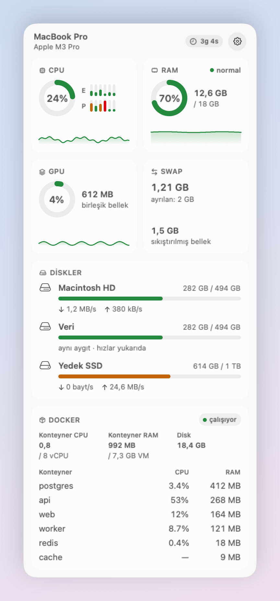
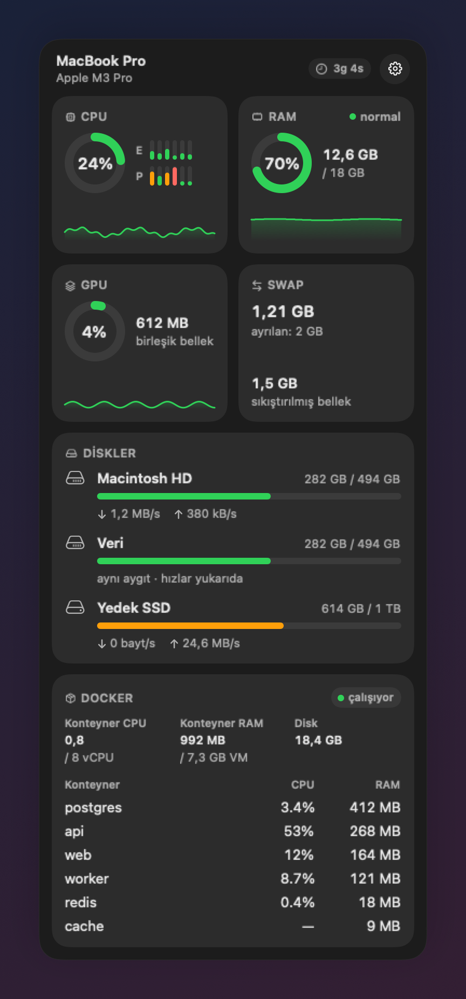

# SystemMetrics

Apple Silicon Mac'ler için menü çubuğunda çalışan, yerel (native) bir macOS uygulaması. CPU,
RAM, GPU, swap, diskler ve Docker kullanımını tek bir panelde gösterir; başka bir uygulama
açmanız gerekmez.

| Açık tema | Koyu tema |
|---|---|
|  |  |

Görüntüler örnek (uydurma) verilerle oluşturuldu; gerçek bir makineye ait değildir.

## Ne gösterir

| Kart | İçerik |
|---|---|
| **CPU** | Toplam kullanım, verimlilik (E) ve performans (P) çekirdekleri ayrı ayrı, son ~5 dakikanın grafiği |
| **RAM** | Kullanılan / toplam bellek ve bellek basıncı (normal / uyarı / kritik) |
| **GPU** | Kullanım yüzdesi ve GPU'nun tuttuğu birleşik bellek |
| **Swap** | Kullanılan swap, ayrılan swap ve sıkıştırılmış bellek |
| **En çok kullananlar** | CPU'ya veya belleğe göre ilk 5 uygulama. Bir uygulamanın yardımcı süreçleri tek satırda toplanır (ör. `Google Chrome ×24`). CPU yüzdesi bir çekirdeğe göredir, Etkinlik Monitörü'ndeki gibi 100%'ü geçebilir. Bellek, Etkinlik Monitörü'ndeki "Bellek" sütunudur (fiziksel ayak izi). Sistemin ve başka kullanıcıların süreçleri (WindowServer, kernel_task…) izin gerektirdiği için listede yer almaz. |
| **Diskler** | Dahili ve harici her birim için dolu / toplam alan, okuma ve yazma hızı |
| **Docker** | Konteynerlerin toplam CPU'su (vCPU) ve RAM'i, Docker VM'inin boyutu, Docker'ın disk kullanımı, RAM'e göre sıralı konteyner listesi (en fazla 6 satır) |

Menü çubuğunda bir ikon ve `CPU 23%  RAM 61%` görünür. Ayarlardan yalnızca ikon, yalnızca CPU
veya yalnızca RAM seçebilirsiniz.

## Kullanım

- **Açma:** İşaretçiyi menü çubuğundaki öğenin üzerinde 300 ms tutun; panel açılır.
- **Kapanma:** İşaretçi hem öğeden hem panelden çıktıktan 500 ms sonra panel kapanır.
- **Sabitleme:** Öğeye tıklayın; panel işaretçi uzaklaşsa da açık kalır. Tekrar tıklamak veya
  Esc'ye basmak paneli kapatır.
- **Panelin dışına tıklamak** paneli her iki modda da kapatır.
- **Ayarlar ve çıkış:** Öğeye sağ tıklayın (veya Control tuşuyla tıklayın). Menüde `Ayarlar…` ve
  `SystemMetrics'ten Çık` bulunur. Ayarlar, panel başlığındaki dişli düğmesinden de açılır.

Ayarlar penceresinde şunlar var:

| Ayar | Seçenekler |
|---|---|
| Güncelleme sıklığı | 1 / 2 / 5 sn (varsayılan 2 sn) |
| Menü çubuğu | CPU ve RAM (varsayılan) / Yalnızca ikon / Yalnızca CPU / Yalnızca RAM |
| Uzak Mac | Boş (varsayılan) ya da bir SSH adı (`~/.ssh/config` içindeki `Host`, makine adı veya `kullanıcı@makine`). Ayrıntılar [Uzak Mac](#uzak-mac) bölümünde. |
| Girişte başlat | Açık / kapalı. Oturum açıldığında uygulamayı başlatır. Ayarlanamazsa sebebi pencerede gösterilir. |

Panel kapalıyken yalnızca menü çubuğundaki iki değer (CPU ve RAM) ölçülür. GPU, swap, disk,
süreç listesi ve Docker yalnızca panel açıkken okunur.

## Gereksinimler

- Apple Silicon (M serisi) bir Mac. Intel Mac'ler desteklenmez.
- macOS 14 veya üstü.
- Kaynaktan derlemek için: Xcode. Testler Swift Testing kullandığı için Xcode 16 veya üstü
  gerekir.
- [XcodeGen](https://github.com/yonaskolb/XcodeGen). `SystemMetrics.xcodeproj` depoda yoktur,
  `project.yml` dosyasından üretilir.

## Kaynaktan derleme

Henüz imzalı ve notarize edilmiş bir sürüm yok (bkz. [Dağıtım ve güvenlik](#dağıtım-ve-güvenlik)).
Uygulamayı kendi makinenizde kaynaktan derleyin.

1. Depoyu klonlayın.

   ```sh
   git clone https://github.com/serhadtekkol/systemmetrics.git
   cd systemmetrics
   ```

2. XcodeGen'i kurun.

   ```sh
   brew install xcodegen
   ```

   Homebrew kullanmıyorsanız, CI'nin kullandığı sabitlenmiş sürümü indirip sağlama toplamını
   doğrulayabilirsiniz:

   ```sh
   curl -fsSL -o xcodegen.zip https://github.com/yonaskolb/XcodeGen/releases/download/2.46.0/xcodegen.zip
   echo "4d9e34b62172d645eed6457cac13fc222569974098ef4ee9c3368bedf0196806  xcodegen.zip" | shasum -a 256 -c -
   unzip -q xcodegen.zip
   ```

   Beklenen çıktı: `xcodegen.zip: OK`. Program `xcodegen/bin/xcodegen` konumundadır; bu
   klasörü `PATH`'e ekleyin.

3. Testleri çalıştırın.

   ```sh
   ./scripts/test.sh
   ```

   Betik Xcode projesini üretir, testleri çalıştırır ve son satırda bir özet yazar:

   ```text
   TESTS: Passed total=176 passed=176 failed=0 skipped=0
   ```

   Sayılar test eklendikçe değişir. Belirleyici olan `Passed` ve `failed=0` kısmıdır. Özetten
   önce derleyici uyarıları basılabilir.

4. Uygulamayı derleyin.

   ```sh
   xcodegen generate
   xcodebuild build -project SystemMetrics.xcodeproj -scheme SystemMetrics -configuration Release \
     -destination 'platform=macOS,arch=arm64' -derivedDataPath build
   ```

   Beklenen çıktının sonu: `** BUILD SUCCEEDED **`. Uygulama
   `build/Build/Products/Release/SystemMetrics.app` konumuna yazılır.

5. Uygulamayı başlatın.

   ```sh
   open build/Build/Products/Release/SystemMetrics.app
   ```

   Menü çubuğunda gösterge ikonu ve CPU / RAM değerleri belirir. Uygulamanın Dock'ta ikonu
   yoktur. Kapatmak için öğeye sağ tıklayıp `SystemMetrics'ten Çık`'ı seçin.

6. Oturum açıldığında başlaması için öğeye sağ tıklayın, `Ayarlar…`'ı seçin ve
   `Girişte başlat`'ı açın.

## Docker

Docker kartı yalnızca Docker kuruluysa görünür. Docker kurulu ama çalışmıyorsa kart
`Docker çalışmıyor` gösterir ve Docker başladığında kendiliğinden düzelir (soket en fazla 10
saniyede bir yeniden denenir).

### Yalnızca okur

Uygulama Docker Engine API'sine unix soketi üzerinden bağlanır ve yalnızca `GET` istekleri
gönderir: `/_ping`, `/containers/json`, `/containers/{id}/stats`, `/system/df` ve `/info`.
Konteyner başlatmaz, durdurmaz, hiçbir şeyi değiştirmez. `docker` komutunu çalıştırmaz.

### Soket nasıl bulunur

Var olan ilk soket kullanılır, şu sırayla:

1. `$DOCKER_HOST`, yalnızca `unix://` ile başlıyorsa. TCP adresleri yok sayılır.
2. Docker CLI'nin geçerli context'i: `$DOCKER_CONTEXT`, yoksa `config.json` içindeki
   `currentContext`. Yapılandırma klasörü `$DOCKER_CONFIG`, yoksa `~/.docker`'dır. Context'in
   adresi `contexts/meta/<sha256(ad)>/meta.json` dosyasındaki `Endpoints.docker.Host`
   alanından okunur (yalnızca `unix://`). `default` context'i 3. adıma geçer.
3. Bilinen soket yolları:
   1. `~/.docker/run/docker.sock` (Docker Desktop)
   2. `~/.orbstack/run/docker.sock` (OrbStack)
   3. `~/.colima/default/docker.sock` (Colima)
   4. `~/.colima/docker.sock` (Colima, eski düzen)
   5. `~/.rd/docker.sock` (Rancher Desktop)
   6. `/var/run/docker.sock`

Finder'dan veya oturum açılışında başlatılan bir uygulama kabuğunuzun ortam değişkenlerini
devralmaz. `.zshrc` içinde tanımladığınız `DOCKER_HOST` uygulamaya ulaşmaz. Özel bir soket
kullanıyorsanız `docker context` ile bir context tanımlayıp onu seçin; uygulama context'i okur.

Hiç soket bulunamazsa uygulama Docker'ın kurulu olup olmadığına şu yollardan bakar:

- `/Applications/Docker.app`, `~/Applications/Docker.app`
- `/Applications/OrbStack.app`, `/Applications/Rancher Desktop.app`
- `docker` veya `colima`, `/usr/local/bin` ya da `/opt/homebrew/bin` altında

Biri varsa kart `Docker çalışmıyor` der. Hiçbiri yoksa kart gizlenir.

### Rakamlar ne anlama gelir

Docker, Mac'te bir sanal makinede (VM) çalışır. Karttaki toplamlar Mac'in değil, bu VM'in
rakamlarıdır.

- **Konteyner CPU**, konteynerlerin kullandığı vCPU sayısıdır. `0,8 / 8 vCPU`, Docker VM'ine
  ayrılan 8 vCPU'dan 0,8'inin kullanıldığını söyler. Mac'in CPU kartıyla toplanmaz.
- **Konteyner listesindeki CPU** `docker stats` ile aynı formülle hesaplanır: bir vCPU'nun
  yüzdesi. İki vCPU'yu dolduran bir konteyner `200%` gösterir. Bir konteynerin ilk ölçümünde
  değer `—` olur, çünkü oran iki ölçüm gerektirir.
- **Konteyner RAM**, `docker stats` gibi kullanım eksi geri kazanılabilir sayfa önbelleğidir
  (cgroup v2'de `inactive_file`, v1'de `total_inactive_file`). Yanındaki `/ 7,3 GB VM`, VM'in
  belleğidir.
- **Disk**, imaj katmanları, volume'lar, build cache ve konteynerlerin yazılabilir katmanlarının
  toplamıdır. 30 saniyede bir yenilenir.

Docker, panel açıkken 4 saniyede bir okunur.

## Uzak Mac

Ayarlar'da **Uzak Mac** doluysa panelin üstünde iki sekme çıkar: **Bu Mac** ve o makine. Menü
çubuğu her zaman bu Mac'in değerlerini gösterir.

- Bağlantı sizin SSH kurulumunuzla yapılır (`/usr/bin/ssh`, anahtarlarınız, `known_hosts`).
  Uygulama yeni port açmaz ve şifre sormaz. Anahtarı tanınmayan bir makineye bağlanmaz: önce
  Terminal'den bir kez `ssh <ad>` ile bağlanıp makineyi onaylayın.
- Karşı Mac'te de SystemMetrics `/Applications` içinde kurulu olmalı, aynı sürüm (0.2.0 veya
  sonrası). Uygulama orada `SystemMetrics --stream` komutunu çalıştırır; bu mod menü çubuğunda
  görünmez, iki saniyede bir tek satırlık JSON yazar ve bağlantı bitince kapanır.
- Bu bağlantıda SSH agent'ı, X11 ve port yönlendirmeleri `~/.ssh/config` ne derse desin kapalıdır.
- Bağlantı koparsa panel nedenini yazar, son gelen değerler görünmeye devam eder ve uygulama
  2, 5, 10, 30, 60 saniye aralıklarla yeniden dener.
- macOS "yerel ağdaki aygıtlar" iznini sorarsa izin verin; yoksa `.local` adlarına
  bağlanılamaz.

İki Mac'in birbirini göstermesi için her birinde diğerinin adını yazın (örneğin Air'de `mini`,
Mac mini'de `air`).

## Rakamlar nasıl tanımlanır

- **RAM kullanılan** = uygulama belleği + wired + sıkıştırılmış. Etkinlik Monitörü ile aynı
  hesaptır (uygulama belleği = internal − purgeable). Menü çubuğundaki RAM yüzdesi bu değerin
  fiziksel belleğe oranıdır.
- **RAM rengi** kullanım yüzdesini değil, bellek basıncını izler. macOS belleği bilerek %80–90
  dolu tutar; yüksek yüzde tek başına sorun değildir.
- **Swap** için yüzde gösterilmez. macOS swap alanını gerektikçe büyütür; "ayrılan" değeri bir
  üst sınır değildir. Kart kullanılan swap'ı, o ana kadar ayrılan boyutu ve sıkıştırılmış
  belleği gösterir.
- **Disk hızları fiziksel aygıta aittir.** Aynı APFS container'ındaki birimler (veya aynı
  diskin bölümleri) aynı sayıları paylaşır. Hızlar aygıtın ilk biriminde gösterilir, diğerlerinde
  `aynı aygıt · hızlar yukarıda` yazar. Panel açıldıktan sonraki ilk ölçümde hız `—` olur.
- **Boş alan**, Finder gibi silinebilir (purgeable) alanı boş sayar.
- **GPU belleği** birleşik belleğin bir parçasıdır ve RAM kartındaki "kullanılan"ın içindedir.
  İkisini toplamayın.

## Bilinen sınırlar

- Sıcaklık ve fan hızı gösterilmez.
- Yalnızca Apple Silicon. Intel Mac'lerde çalışmaz.
- GPU verisi IOKit'teki belgelenmemiş anahtarlardan okunur (`Device Utilization %`,
  `In use system memory`). Apple bu anahtarları değiştirirse GPU kartı `veri yok` gösterir.
- Ağ birimleri (SMB, NFS, AFP, WebDAV) gösterilmez. Yalnızca yerel birimler listelenir: kök
  birim ve `/Volumes/` altındakiler.
- Docker'da bir ölçümde en fazla 30 konteyner okunur; toplamlar bu konteynerlerden hesaplanır.
  Panelde 6 satır gösterilir, fazlası `+N daha` olarak yazılır.

## Dağıtım ve güvenlik

Henüz Developer ID ile imzalanmış ve notarize edilmiş bir sürüm yok. Böyle bir sürüm
yayımlanana kadar SystemMetrics yalnızca kaynaktan derlenerek kullanılır. Başkasının derleyip
gönderdiği bir `SystemMetrics.app`'i çalıştırmayın ve macOS'un güvenlik uyarılarını devre dışı
bırakmayın.

Uygulama App Sandbox olmadan çalışır; Docker soketine ve IOKit'e erişmek için bu gereklidir.

## Gizlilik

- Uygulama internete bağlanmaz. Yerel Docker unix soketine ve, Uzak Mac ayarlıysa, yalnızca o
  makineye SSH ile bağlanır. Karşı Mac'e giden tek şey sabit bir komuttur; gelen veri yalnızca
  panelde gösterilir, kaydedilmez.
- Telemetri veya kullanım verisi toplamaz.
- Yalnızca Docker hatalarını sistem günlüğüne yazar (`com.serhadtekkol.SystemMetrics`,
  kategori `docker`, `info` düzeyi). Konteyner adları gizli (`private`) olarak işaretlenir;
  soket yolları ve yanıt içerikleri hiç yazılmaz.
- Uzak Mac bağlantı hataları kategori `remote` altında yazılır; karşı makineden gelen hata metni
  gizli (`private`) olarak işaretlenir.

## Katkı ve testler

Testleri çalıştırın:

```sh
./scripts/test.sh
```

Ek argümanlar `xcodebuild`'e geçer. Tek bir test grubunu çalıştırmak için:

```sh
./scripts/test.sh -only-testing:MetricsKitTests/CPUCalculatorTests
```

`CI` ortam değişkeni tanımlıysa gerçek donanımı ve gerçek Docker soketini okuyan testler
atlanır. CI'yi yerelde taklit etmek için:

```sh
CI=1 ./scripts/test.sh
```

Beklenen çıktı `skipped` sayısının sıfırdan büyük olduğu bir özettir, örneğin
`TESTS: Passed total=176 passed=146 failed=0 skipped=30`.

GitHub Actions iş akışı (`.github/workflows/ci.yml`) her push ve pull request'te aynı betiği
`CI=1` ile çalıştırır.

## Lisans

MIT. Ayrıntılar için [LICENSE](LICENSE) dosyasına bakın.
